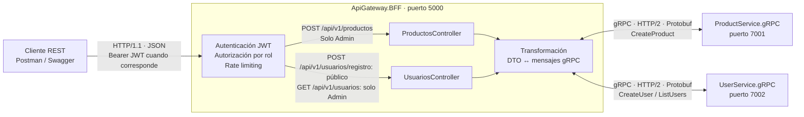

# Microservicios Resilientes Nivel 2

## Tarea 1 - Arquitectura híbrida REST/gRPC con JWT

### Grupo
*	Víctor Hugo Ulloa Meléndez

### Cómo levantar el sistema
#### Linux
1.	Asegúrese de que Docker se encuentra instalado y ejecutando

2.	Confirme con 

```bash
docker version
```

3.	Vaya a la carpeta Infrastructure del repositorio y construya:

```bash
cd /opt/ECommerceGRPC_Clase2/Infrastructure
docker compose up -d --build
```

La ruta /opt/ECommerceGRPC_Clase2/Infrastructure es un ejemplo, corrija para que coincida con la ruta real de su equipo.

4.	Verifique que los 7 contenedores ejecutan

```bash
docker ps | grep c2
```


#### Windows

1.	Asegúrese de abrir Docker Desktop para que el servidor Docker inicie

2.	Confirme con 

```powershell
docker version
```

3.	Vaya a la carpeta Infrastructure del repositorio y construya:

```powershell
cd /cursos/micro2/ECommerceGRPC_Clase2/Infrastructure
docker compose up -d --build
```
La ruta /cursos/micro2/ECommerceGRPC_Clase2/Infrastructure es un ejemplo, corrija para que coincida con la ruta real de su equipo.

4.	Verifique que los 7 contenedores ejecutan

```powershell
docker container ls --filter name=c2
```

### Endpoints

Para los endpoint que lo requieren, el token de prueba se obtiene con POST /api/auth/login y Swagger está en http://localhost:5000/swagger

| Endpoint | Acceso | Solicitud | Código | Resultado |
|---|---|---|---|----|
| POST /api/v1/productos | Admin | http://localhost:5000/api/v1/productos | 201 | Registro nuevo creado |
| POST /api/v1/usuarios/registro | Público, sin token | http://localhost:5000/api/v1/usuarios/registro | 201 | Registro nuevo creado |
| GET /api/v1/usuarios | Admin | http://localhost:5000/api/v1/usuarios | 200 | Lista de usuarios |

#### Ejemplos de solicitud y respuesta

Los siguientes ejemplos son ilustrativos: los identificadores, las fechas y
el contenido de las listas dependen de los datos de cada ejecución.
En Postman, use Body → raw → JSON para los POST.

Para obtener un token Admin, envíe:

```http
POST http://localhost:5000/api/auth/login
Content-Type: application/json

{
  "email": "admin@example.com",
  "clave": "Admin2026!"
}
```

Copie el campo `token` de la respuesta y sustituya `<token_admin>` por su
valor real, sin los signos `< >`, en los ejemplos siguientes.

##### Crear producto

Requiere el rol Admin. La política `escrituras` permite 3 solicitudes por
usuario cada 30 segundos; se comparte con el PUT de stock.

Solicitud:

```http
POST http://localhost:5000/api/v1/productos
Authorization: Bearer <token_admin>
Content-Type: application/json

{
  "nombre": "Laptop de prueba Tarea 1",
  "descripcion": "Laptop para demostrar la creación de productos",
  "precio": 850.50,
  "stock": 5,
  "categoria": "Laptops"
}
```

Respuesta de ejemplo: **201 Created**. El encabezado `Location` apunta al
GET del producto creado, por ejemplo
`http://localhost:5000/api/v1/productos/4`.

```json
{
  "id": 4,
  "nombre": "Laptop de prueba Tarea 1",
  "descripcion": "Laptop para demostrar la creación de productos",
  "precio": 850.50,
  "categoria": "Laptops",
  "stock": 5,
  "disponible": true
}
```

Otras respuestas: **400** por datos inválidos, **401** sin token válido,
**403** sin rol Admin, **409** por nombre repetido y **429** al superar
el límite de solicitudes. Cambie el nombre para repetir una creación exitosa.

##### Registrar usuario

Es público: no requiere encabezado `Authorization`. Utiliza la política
`login`, que admite 10 solicitudes por minuto por IP y se comparte con
el inicio de sesión.

Solicitud:

```http
POST http://localhost:5000/api/v1/usuarios/registro
Content-Type: application/json

{
  "email": "ana.tarea1@example.com",
  "nombre": "Ana",
  "apellido": "Pérez",
  "clave": "Prueba2026!"
}
```

Respuesta de ejemplo: **201 Created**. El encabezado `Location` apunta al
GET del usuario creado, por ejemplo
`http://localhost:5000/api/v1/usuarios/3`.

```json
{
  "id": 3,
  "email": "ana.tarea1@example.com",
  "nombreCompleto": "Ana Pérez",
  "activo": true,
  "creadoEl": "2026-11-13T15:00:00Z"
}
```

La respuesta no incluye la contraseña ni su hash. Otras respuestas:
**400** por datos inválidos, **409** por correo repetido y **429** al superar
el límite de solicitudes. Cambie el correo para repetir un registro exitoso.

##### Listar usuarios

Requiere el rol Admin. Utiliza la política `lecturas`: 10 solicitudes cada
10 segundos por IP, compartidas con los demás endpoints de esa política.

Solicitud **sin cuerpo**:

```http
GET http://localhost:5000/api/v1/usuarios
Authorization: Bearer <token_admin>
```

Respuesta de ejemplo: **200 OK**. El gateway consume el server streaming
de `ListUsers` y devuelve un arreglo JSON de usuarios activos. El arreglo
siguiente ilustra una lista con un usuario; la respuesta real incluye
todos los usuarios activos y puede ser `[]` si no hay ninguno.

```json
[
  {
    "id": 3,
    "email": "ana.tarea1@example.com",
    "nombreCompleto": "Ana Pérez",
    "activo": true,
    "creadoEl": "2026-11-13T15:00:00Z"
  }
]
```

Otras respuestas: **401** sin token válido, **403** sin rol Admin y **429**
al superar el límite de solicitudes.

### Usuarios de prueba

Usuario regular: user@example.com / Cliente2026!
Usuario administrador: admin@example.com / Admin2026!

### Diagrama

